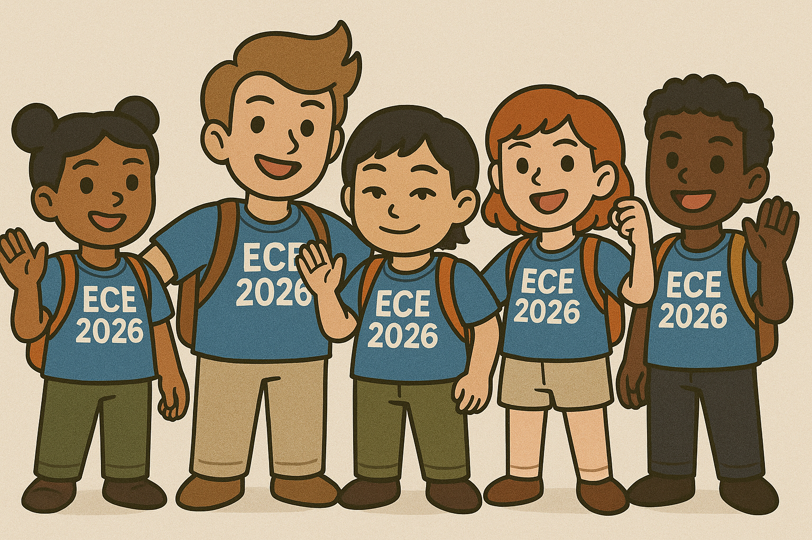

# Team 3: HUDini

This is our team

## Description
We’re building a live translation device that utilizes a microphone and Head-Up Display (HUD) to turn spoken foreign speech into real-time English captions, all housed in a pair of glasses. A companion app learns user style to suggest relevant replies, which are displayed phonetically for easy pronunciation on the HUD.

## Objectives
The HUDini will enable fluid two-way conversation, accelerate language learning, and generally facilitate communication across various languages. Planned deliverables: working product with live speech translation and response suggestion.

## Team links
- [Team Google Drive]()

## Course links
- [ECE Senior Design Piazza Site](https://piazza.com/bu/fall2025/ec463/home)
- [Blackboard](http://learn.bu.edu/)

## Optional features links
- Team Jira
- Team Confluence
- Something else

